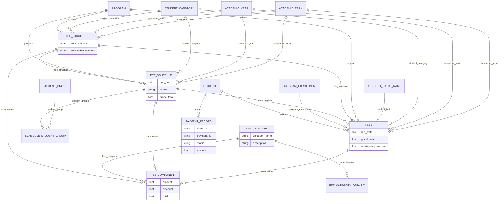
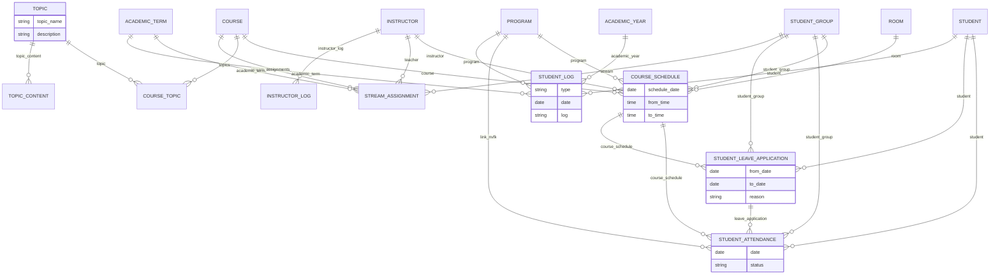

# Education app entity-relationship diagrams

These diagrams are based on the app's DocType JSON definitions in
[`education/education/doctype`](../education/education/doctype). They focus on
the main data relationships, so only representative fields are shown rather
than every field on every form.

`||--o{` means one parent can be related to zero or many child records. Links
are derived from Link and Table fields in the DocType definitions; they
describe app-level relationships and do not necessarily imply database foreign
key constraints. External doctypes such as `Department`, `Company`, and
`Employee` are outside the Education app and are omitted from the diagrams.

## Academic structure, admissions, and enrollment

```mermaid
erDiagram
    ACADEMIC_YEAR ||--o{ ACADEMIC_TERM : academic_year
    ACADEMIC_YEAR ||--o{ STUDENT_ADMISSION : academic_year
    ACADEMIC_YEAR ||--o{ STUDENT_APPLICANT : academic_year
    ACADEMIC_YEAR ||--o{ PROGRAM_ENROLLMENT : academic_year
    ACADEMIC_YEAR ||--o{ STUDENT_GROUP : academic_year

    STUDENT_ADMISSION ||--o{ ADMISSION_PROGRAM : program_details
    PROGRAM ||--o{ ADMISSION_PROGRAM : program
    STUDENT_ADMISSION ||--o{ STUDENT_APPLICANT : student_admission
    PROGRAM ||--o{ STUDENT_APPLICANT : program
    ACADEMIC_TERM ||--o{ STUDENT_APPLICANT : academic_term
    STUDENT_CATEGORY ||--o{ STUDENT_APPLICANT : student_category
    STUDENT_APPLICANT ||--o{ STUDENT : student_applicant

    STUDENT ||--o{ PROGRAM_ENROLLMENT : student
    PROGRAM ||--o{ PROGRAM_ENROLLMENT : program
    ACADEMIC_TERM ||--o{ PROGRAM_ENROLLMENT : academic_term
    STUDENT_CATEGORY ||--o{ PROGRAM_ENROLLMENT : student_category
    STUDENT_BATCH_NAME ||--o{ PROGRAM_ENROLLMENT : student_batch_name
    SCHOOL_HOUSE ||--o{ PROGRAM_ENROLLMENT : school_house
    PROGRAM_ENROLLMENT ||--o{ PROGRAM_ENROLLMENT_COURSE : courses
    COURSE ||--o{ PROGRAM_ENROLLMENT_COURSE : course
    PROGRAM_ENROLLMENT ||--o{ PROGRAM_FEE : fees
    ACADEMIC_TERM ||--o{ PROGRAM_FEE : academic_term
    STUDENT_CATEGORY ||--o{ PROGRAM_FEE : student_category
    FEE_SCHEDULE ||--o{ PROGRAM_FEE : fee_schedule

    PROGRAM ||--o{ PROGRAM_COURSE : courses
    COURSE ||--o{ PROGRAM_COURSE : course
    COURSE ||--o{ COURSE_ENROLLMENT : course
    STUDENT ||--o{ COURSE_ENROLLMENT : student
    PROGRAM ||--o{ COURSE_ENROLLMENT : program
    PROGRAM_ENROLLMENT ||--o{ COURSE_ENROLLMENT : program_enrollment
    COURSE ||--o{ COURSE_ACTIVITY : course
    STUDENT ||--o{ COURSE_ACTIVITY : student
    COURSE_ENROLLMENT ||--o{ COURSE_ACTIVITY : enrollment

    PROGRAM ||--o{ STUDENT_GROUP : program
    COURSE ||--o{ STUDENT_GROUP : course
    ACADEMIC_TERM ||--o{ STUDENT_GROUP : academic_term
    STUDENT_BATCH_NAME ||--o{ STUDENT_GROUP : batch
    ROOM ||--o{ STUDENT_GROUP : default_room
    STUDENT_CATEGORY ||--o{ STUDENT_GROUP : student_category
    STUDENT_GROUP ||--o{ GROUP_STUDENT : students
    STUDENT ||--o{ GROUP_STUDENT : student
    STUDENT_GROUP ||--o{ GROUP_INSTRUCTOR : instructors
    INSTRUCTOR ||--o{ GROUP_INSTRUCTOR : instructor

    ASSESSMENT_GROUP ||--o{ ASSESSMENT_GROUP : parent_assessment_group
    STUDENT ||--o{ STUDENT_GUARDIAN : guardians
    STUDENT_APPLICANT ||--o{ STUDENT_GUARDIAN : guardians
    GUARDIAN ||--o{ STUDENT_GUARDIAN : guardian
    GUARDIAN ||--o{ GUARDIAN_STUDENT : students
    STUDENT ||--o{ GUARDIAN_STUDENT : student
    GUARDIAN ||--o{ GUARDIAN_INTEREST : interests
    STUDENT ||--o{ STUDENT_SIBLING : siblings
    STUDENT_APPLICANT ||--o{ STUDENT_SIBLING : siblings

    ACADEMIC_YEAR {
        string academic_year_name
        date year_start_date
        date year_end_date
    }
    ACADEMIC_TERM {
        string term_name
        date term_start_date
        date term_end_date
    }
    PROGRAM {
        string program_name
        string program_abbreviation
    }
    PROGRAM_COURSE {
        string course
        boolean required
    }
    COURSE {
        string course_name
        string description
    }
    STUDENT {
        string student_name
        string student_email_id
        boolean enabled
        date joining_date
    }
    STUDENT_APPLICANT {
        string title
        string application_status
        date application_date
    }
    PROGRAM_ENROLLMENT {
        date enrollment_date
        string boarding_student
    }
    COURSE_ENROLLMENT {
        date enrollment_date
    }
    STUDENT_GROUP {
        string student_group_name
        string group_based_on
        boolean disabled
    }
    GUARDIAN {
        string guardian_name
        string email_address
        string mobile_number
    }
    INSTRUCTOR {
        string instructor_name
        string status
    }
```

**How to read it:** A Program contains Courses. A student can have Program
Enrollments for different academic years, and each enrollment can list courses
and fees. Student Groups organize students and instructors for a year/term.
Guardians and siblings are recorded from the student and/or guardian forms.

## Assessment, grading, and quizzes

```mermaid
erDiagram
    ASSESSMENT_GROUP ||--o{ ASSESSMENT_PLAN : assessment_group
    STUDENT_GROUP ||--o{ ASSESSMENT_PLAN : student_group
    COURSE ||--o{ ASSESSMENT_PLAN : course
    PROGRAM ||--o{ ASSESSMENT_PLAN : program
    ACADEMIC_YEAR ||--o{ ASSESSMENT_PLAN : academic_year
    ACADEMIC_TERM ||--o{ ASSESSMENT_PLAN : academic_term
    GRADING_SCALE ||--o{ ASSESSMENT_PLAN : grading_scale
    ASSESSMENT_PLAN ||--o{ PLAN_CRITERIA : assessment_criteria
    ASSESSMENT_CRITERIA ||--o{ PLAN_CRITERIA : assessment_criteria

    ASSESSMENT_GROUP ||--o{ ASSESSMENT_RESULT : assessment_group
    ASSESSMENT_PLAN ||--o{ ASSESSMENT_RESULT : assessment_plan
    STUDENT ||--o{ ASSESSMENT_RESULT : student
    STUDENT_GROUP ||--o{ ASSESSMENT_RESULT : student_group
    COURSE ||--o{ ASSESSMENT_RESULT : course
    PROGRAM ||--o{ ASSESSMENT_RESULT : program
    ACADEMIC_YEAR ||--o{ ASSESSMENT_RESULT : academic_year
    ACADEMIC_TERM ||--o{ ASSESSMENT_RESULT : academic_term
    GRADING_SCALE ||--o{ ASSESSMENT_RESULT : grading_scale
    ASSESSMENT_RESULT ||--o{ RESULT_DETAIL : details
    ASSESSMENT_CRITERIA ||--o{ RESULT_DETAIL : assessment_criteria

    ASSESSMENT_CRITERIA_GROUP ||--o{ ASSESSMENT_CRITERIA : group
    GRADING_SCALE ||--o{ GRADING_INTERVAL : intervals
    COURSE ||--o{ COURSE_CRITERIA : assessment_criteria
    ASSESSMENT_CRITERIA ||--o{ COURSE_CRITERIA : assessment_criteria

    QUESTION ||--o{ QUESTION_OPTION : options
    QUIZ ||--o{ QUIZ_QUESTION : question
    QUESTION ||--o{ QUIZ_QUESTION : question_link
    COURSE_ENROLLMENT ||--o{ QUIZ_ACTIVITY : enrollment
    QUIZ ||--o{ QUIZ_ACTIVITY : quiz
    STUDENT ||--o{ QUIZ_ACTIVITY : student
    COURSE ||--o{ QUIZ_ACTIVITY : course
    QUIZ_ACTIVITY ||--o{ QUIZ_RESULT : result
    QUESTION ||--o{ QUIZ_RESULT : question

    ASSESSMENT_PLAN {
        string assessment_name
        date schedule_date
        float maximum_assessment_score
    }
    ASSESSMENT_RESULT {
        float maximum_score
        float total_score
        string grade
        string comment
    }
    RESULT_DETAIL {
        float maximum_score
        float score
        string grade
    }
    ASSESSMENT_CRITERIA {
        string assessment_criteria
    }
    GRADING_SCALE {
        string grading_scale_name
        string description
    }
    GRADING_INTERVAL {
        string grade_code
        float threshold
        string grade_description
    }
    QUIZ {
        string title
        float passing_score
        int max_attempts
    }
    QUIZ_ACTIVITY {
        string status
        float score
        int time_taken
    }
```

Assessment Results store scores and grades against an Assessment Plan. Grading
Scales map thresholds to grade codes. Quiz attempts are separate from
Assessment Results; the enrollment/promotion workflow does not itself link a
quiz pass/fail result to promotion eligibility.

## Fees and payments

Fee Structures define charges, Fee Schedules apply them to a program or student
group, and Fees are student-level billing records. Payment Record tracks
payment details and can reference an ERPNext Sales Invoice.

## Attendance, timetable, and supporting records

## Workflow tools and standalone DocTypes

Tool DocTypes are forms that gather inputs and perform an operation; their
fields should not be interpreted as durable business-record relationships.

| Tool or standalone DocType | Main fields / purpose |
|---|---|
| **Program Enrollment Tool** *(single)* | Source Program/year/term/batch, selected students, destination Program/year/term/batch, enrollment date. Creates new Program Enrollments. |
| **Program Enrollment Tool Student** *(child-row)* | Selected student/applicant, name, batch, category. |
| **Student Group Creation Tool** *(single)* | Academic year/term, Program, grouping option, courses. |
| **Student Group Creation Tool Course** *(child-row)* | Grouping mode, Course, batch, group name, max strength. |
| **Student Attendance Tool** *(single)* | Attendance basis, Student Group or Course Schedule, date, year/term. |
| **Assessment Result Tool** *(single)* | Assessment Plan and Student Group selection. |
| **Course Scheduling Tool** *(single)* | Student Group, Course, Program, year/term, instructor, room, date range, times. |
| **Timetable Generator** *(single)* | Year/term plus rules, time slots, breaks, teacher preferences, and room assignments. |
| **Student Report Generation Tool** *(single)* | Student, Program, batch, year/term, assessment group, marks and report options. |
| **Education Settings** *(single)* | Defaults and app behavior such as current year/term, attendance, validation, billing, and branding. |
| **Timetable Generation Result** | Result status/counts, unscheduled subjects, and generated timetable snapshot. |
| **Break** / **Breaks** *(child-row)* | Break definition and its use in a timetable configuration. |
| **Subject Rules** *(child-row)* | Course scheduling limits and weekly frequency. |
| **Teacher Preference** *(child-row)* | Instructor/Course/Student Group scheduling preferences. |
| **Teaching Rooms** *(child-row)* | Room preference for Course and Student Group. |
| **Time Slots** *(child-row)* | Timetable period, start/end, duration, double-period flag. |
| **Fee Schedule Program** *(child-row)* | Program, batch, and student count. No parent Table field references this DocType in the current definitions. |
| **Fee Schedule Details** *(child-row)* | Month, due date, amount. No parent Table field references this DocType in the current definitions. |
| **Program Enrollment Fee** *(child-row)* | Term, Fee Structure, due date, amount. The current Program Enrollment form uses **Program Fee** rows instead. |
| **Student Siblings** *(child-row)* | Alternate/simple sibling row DocType; the Student and Student Applicant forms currently use **Student Sibling**. |
| **Student Language** | Language name. No Link/Table relationship to Student is defined in the current DocTypes. |
| **Article** | Title, author, content, publish date. |
| **Student Batch Name**, **Student Category**, **School House**, **Room** | Lookup/reference records used by enrollment, group, or scheduling forms. |
| **Question**, **Options**, **Quiz**, **Quiz Question**, **Quiz Result**, **Quiz Activity** | Quiz definition and attempt records; detailed result links are shown in the assessment diagram. |
